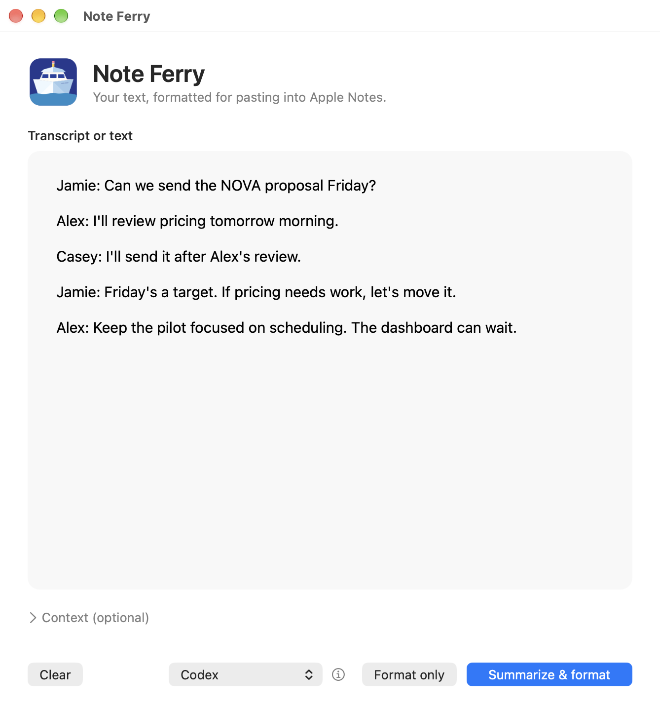
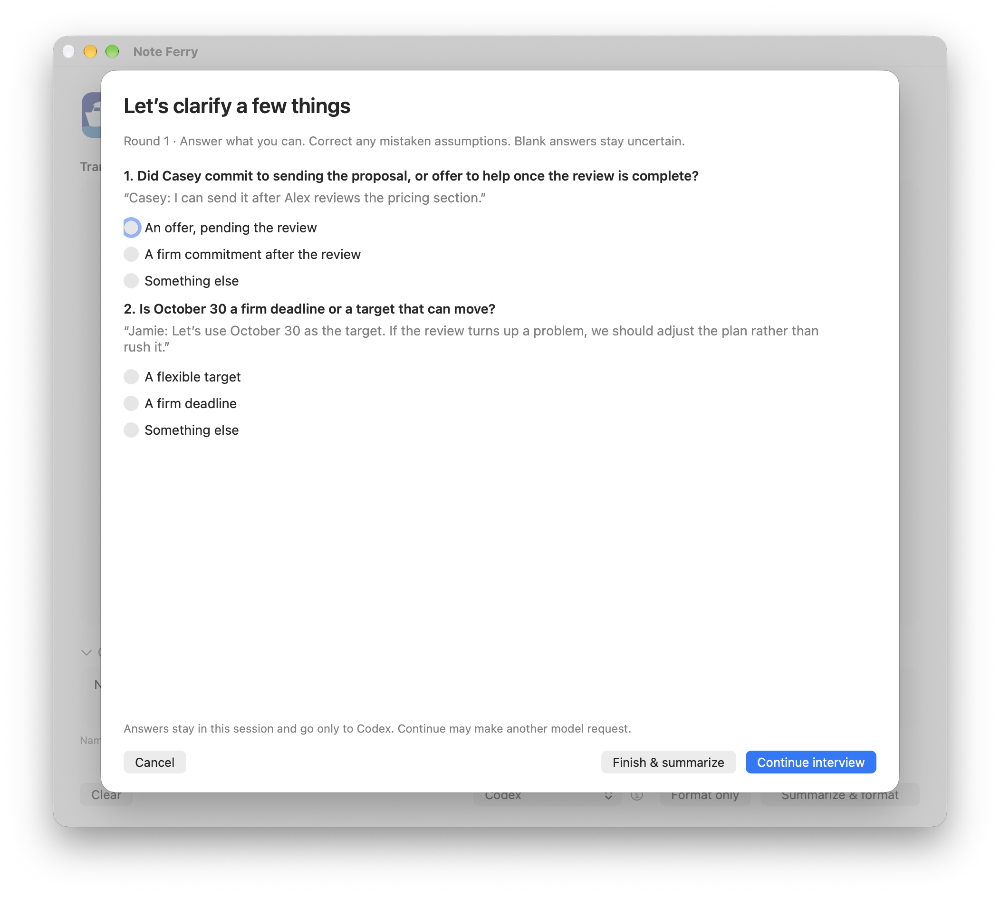

# Note Ferry

**Turn your text into notes worth keeping.**

Summarize a transcript or format writing you already want to keep, then paste it into Apple Notes. You choose where to paste. Note Ferry never creates or edits an Apple Note.

<strong>Start with messy text → Ready for Apple Notes</strong>

  
  

*From conversation to clear notes, ready for Apple Notes. Fictional example; click either window for a closer look.*

## Download

**[Download Note Ferry 2.1 for Mac](https://github.com/niederme/note-ferry/releases/download/v2.1/Note-Ferry-2.1-universal.zip)**

Free and open source. No app subscription. Signed with Developer ID and notarized by Apple.

Requires macOS 14+. Universal for Apple silicon and Intel. Unzip into Applications, or choose **Note Ferry → Check for Updates…**.

Tested on Apple silicon with macOS 27; Intel and older macOS versions remain untested. [Release notes and checksum](https://github.com/niederme/note-ferry/releases/tag/v2.1).

## How it works

Start with **Use Format Only** or **Set Up Summaries**. Revisit **Settings → Run Setup Again…** without losing preferences.

1. **Paste your text.** Bring a transcript, AI reply, or notes. Add optional context for names or background.
2. **Summarize or format.** Choose **Summarize & format** for takeaways and action items, or **Format only** to preserve your wording locally, without AI or an account.
3. **Paste the copied result into Apple Notes with ⌘V.** Review important details in AI-generated summaries.

*The action bar stays at the bottom while you work. Nothing runs merely because you paste.*

## Clarify before summarizing

The model asks about unclear details when needed, using source excerpts and suggested answers. Choose an answer, write your own, or leave it blank. **Continue interview** allows follow-ups; **Finish & summarize** proceeds now. **Answers…** reviews earlier responses; **Summarize now** skips a pending check.

Interviews are on by default; disable **Ask clarifying questions before summarizing** in Settings to skip them. They use extra time and tokens, and Claude API calls can cost more.

*Use the source excerpts to check the question’s premise.*

## Choose a summarizer

| Provider | What you need | Where text goes |
| --- | --- | --- |
| **Apple Intelligence** | A compatible Mac with macOS 26+ and Apple Intelligence enabled | Stays on your Mac |
| **Codex** | The Codex CLI, a signed-in account, and internet access | OpenAI, using your Codex account |
| **Claude** | Your Anthropic API key and internet access; API billing is separate from a Claude subscription | Anthropic |

Choose a default in Settings or switch providers in the bottom action bar. [Setup instructions](docs/USER_GUIDE.md#choose-a-summarizer).

No transcript library. Your newer clipboard is protected if you copy something else while processing; use **Copy summary** or **Copy formatted text** when ready. [Privacy details](docs/PRIVACY.md).

See the finished summary in Note Ferry

## More

[User guide](docs/USER_GUIDE.md) · [Report a problem](https://github.com/niederme/note-ferry/issues) · [Development](docs/DEVELOPMENT.md) · [Roadmap](ROADMAP.md)

Created by **John Niedermeyer**, with AI-assisted development. [MIT License](LICENSE). Sparkle has its [own license](Resources/Sparkle.LICENSE).
