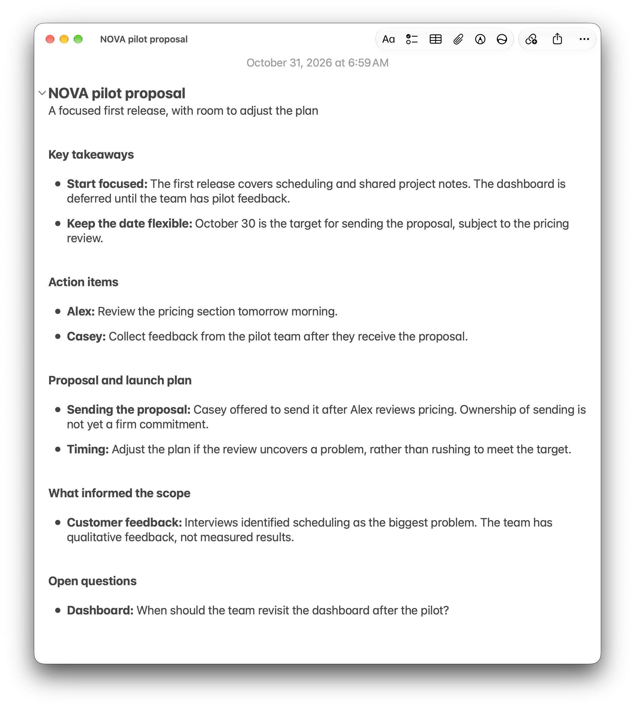
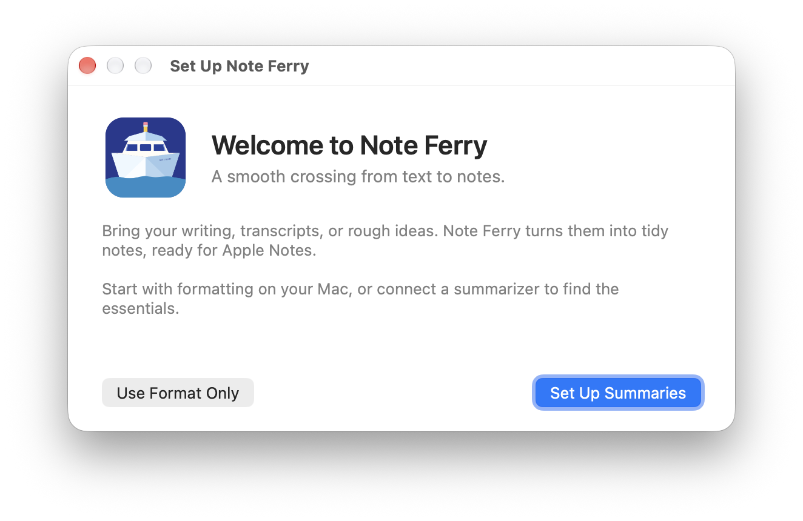
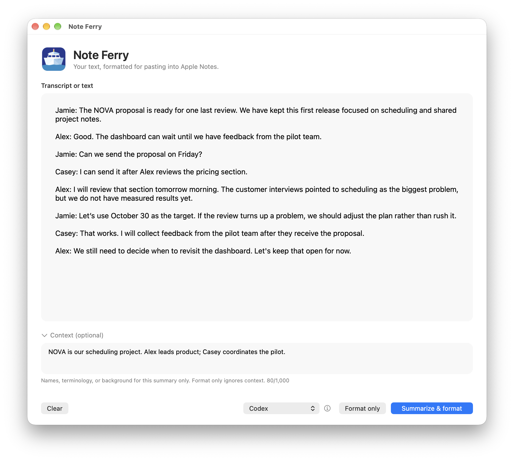
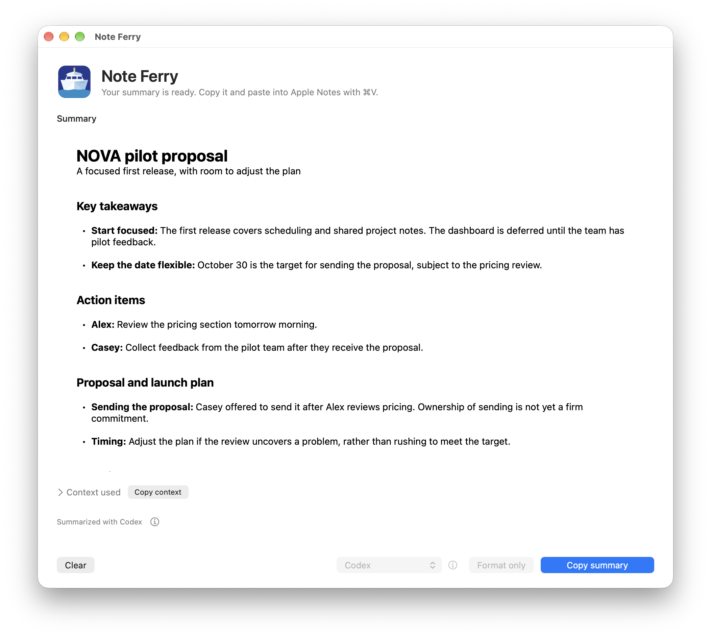

# Note Ferry

**Turn your text into notes worth keeping.**

Note Ferry turns text into formatted notes you can paste into Apple Notes. Summarize a transcript or format writing you already want to keep.

You choose where to paste. Note Ferry never creates or edits an Apple Note.

## Download

**2.0.1 is in preparation.** The updated interface below is available in the [source build](docs/DEVELOPMENT.md#install-from-source); the current signed download is 2.0.

**[Download Note Ferry 2.0 for Mac](https://github.com/niederme/note-ferry/releases/download/v2.0/Note-Ferry-2.0-universal.zip)**

Free and open source. No app subscription. Signed with Developer ID and notarized by Apple.

Requires macOS 14 or later. Includes Apple silicon and Intel versions. Unzip and move **Note Ferry.app** to Applications, or choose **Note Ferry → Check for Updates…** in an existing installation.

Runtime testing has been on Apple silicon with macOS 27; Intel hardware and older macOS versions have not been tested. [Release notes and checksum](https://github.com/niederme/note-ferry/releases/tag/v2.0).

*Your finished notes, pasted into Apple Notes. All screenshot examples are fictional.*

## How it works

On first launch, choose **Use Format Only** to start locally or **Set Up Summaries** to connect a summarizer. Revisit setup from **Settings → Run Setup Again…** without losing saved preferences.

1. **Paste your text.** Bring a transcript, an AI reply, or your own notes. Add optional context for names, terminology, or background.
2. **Summarize or format.** Choose **Summarize & format** for takeaways, action items, and topic notes. Choose **Format only** to preserve your wording and format locally, without AI or an account.
3. **When the result is ready and copied, paste into Apple Notes with ⌘V.** Use normal Paste to keep the formatting. Review important details in AI-generated summaries.

*The action bar stays at the bottom while you work. Nothing runs merely because you paste.*

## Clarify before summarizing

The model can ask about unclear details before writing the summary. If it has no questions, it continues automatically. Questions can include relevant excerpts and suggested answers. Choose an answer, write your own, or leave it blank. **Continue interview** allows follow-ups; **Finish & summarize** proceeds with whatever you’ve answered. Use **Answers…** to review earlier responses, or **Summarize now** to skip a pending question check.

The interview is on by default. Turn off **Ask clarifying questions before summarizing** in Settings to skip the interview. Interviews take extra time and tokens, and Claude API requests can cost more.

*Use the source excerpts to check the question’s premise.*

## Choose a summarizer

| Provider | What you need | Where text goes |
| --- | --- | --- |
| **Apple Intelligence** | A compatible Mac with macOS 26+ and Apple Intelligence enabled | Stays on your Mac |
| **Codex** | The Codex CLI, a signed-in account, and internet access | OpenAI, using your Codex account |
| **Claude** | Your Anthropic API key and internet access; API billing is separate from a Claude subscription | Anthropic |

Choose a default in Settings or switch providers in the bottom action bar. [Setup instructions](docs/USER_GUIDE.md#choose-a-summarizer).

Note Ferry keeps no transcript library. If you copy something else while it works, it protects your newer clipboard. Choose **Copy summary** or **Copy formatted text** when you’re ready. [Privacy details](docs/PRIVACY.md).

See the finished summary in Note Ferry

## More

[User guide](docs/USER_GUIDE.md) · [Report a problem](https://github.com/niederme/note-ferry/issues) · [Development](docs/DEVELOPMENT.md) · [Roadmap](ROADMAP.md)

Created by **John Niedermeyer**, with AI-assisted development. [MIT License](LICENSE). Sparkle has its [own license](Resources/Sparkle.LICENSE).
